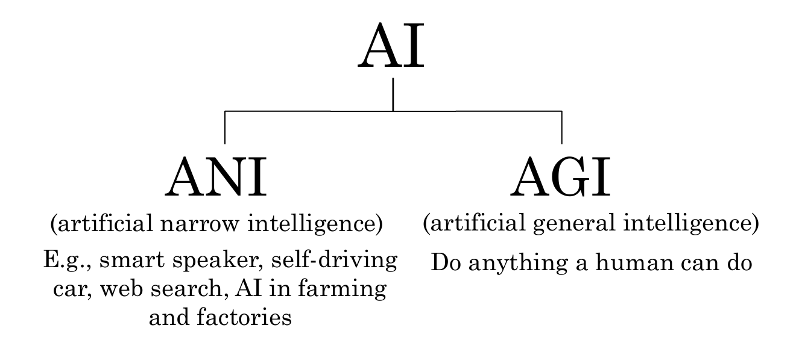
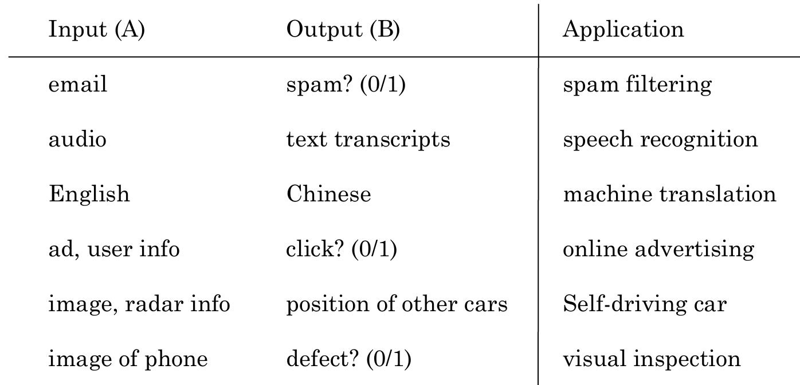

# AI for everyone

# 什么是AI

* ANI(artificial narrow intelligence) 弱人工智能
* AGI(artificial general intelligence) 强人工智能

## 机器学习

机器学习主要包含以下几个类别：

* 监督学习（Supervised Learning）
     * 使用已知输入和输出来训练模型、以便对新的未知数据进行预测。
     * 常见的任务类型包括分类（Classification）和回归（Regression）。
* 非监督学习（Unsupervised Learning）
    * 使用无标签的数据，目的是找出数据内部的结构或模式。
    * 典型任务包括聚类（Clustering）、降维（Dimensionality Reduction）、异常检测（Anomaly Detection）等。
* 强化学习（Reinforcement Learning）
    * 让一个代理通过与环境的交互来学习决策规则。代理会根据环境反馈的奖励或惩罚来调整其行为，以便在未来获得最大的累积奖励。
    * 应用场景包括游戏、机器人控制、资源调度等领域。
* 半监督学习（Semi-supervised Learning）：
    * 半监督学习介于监督学习和非监督学习之间。它利用少量的带标签数据和大量的无标签数据来进行学习，以提高模型的性能。
    * 这种方法在**标签难以获得或成本高昂的情况下非常有用。**
* 自监督学习（Self-supervised Learning）：
    * 自监督学习是一种特定类型的无监督学习，它通过构造伪标签（pseudo-labels）来指导模型学习。这种方法通常用于预训练阶段，在不需要人工标注的情况下让模型学习到有用的表征。
    * 该技术常用于**视觉、语音和自然语言处理任务**。

### 监督学习

监督学习的demo:

## 什么是数据

获取数据

* 手工标签
* 观察用户行为
* 从网站/合作伙伴下载

脏数据的危害：

* garbage in, garbage out   数据的重要性
* 数据问题
    * 错误标签
    * 缺失值
* 多种类型的数据
    * 图像、音频、文本（归一化处理）

## AI术语

* 机器学习： 一门研究领域，赋予计算机无需明确编程就能学习的能力。
    * 主要类型：监督学习、非监督学习、强化学习、半监督学习、深度学习
* 数据科学： 从大量数据中提取有价值的信息。
    * 关键技能：数据清洗和预处理、统计分析、数据可视化、数据挖掘、数据库管理、编程能力（如Python、R）、业务理解能力

## 什么创建了AI公司

**人工智能转型手册（AI Transformation）**

1. 执行试点项目以获得动力。
2. 建立一个内部AI团队。
3. 提供广泛的人工智能培训。
4. 制定人工智能战略。
5. 发展内部和外部的沟通
    * IT团队   AI团队
    * 交互，确定AI团队需要的data，具体内容，标签等

深度学习 神经网络

## 机器学习可以做什么和不可以做什么

**明白AI能做和不能做的事情** ————>  很重要

不能做的事情：AI做市场调研，且给出50页的分析报告

自动驾驶汽车：可以识别前方车辆，不能识别各个人不同的手势含义

### 机器学习的优缺点

ML can do well in

1. 简单的概念
2. 大量可靠数据

ML can not do well in

1. 从少量数据中学习复杂概念
2. 用系统从未见过的新类型数据去执行任务

构造一个系统做 A ——> B 映射

AI 缺乏举一反三的能力

构建神经网络

speech recognition  语音识别

# 构建AI项目

**机器学习项目的关键步骤**

1. 收集数据
2. 训练模型
    * 迭代多次直到效果足够
3. 部署模型 
    * 获取数据
    * 维护/更新模型

实践：

自动驾驶汽车

1. 收集数据  ———— 图像，其他车辆的位置信息 
2. 训练模型
    * 迭代多次直到效果足够
3. 部署模型 
    * 获取数据  ———— 获取新的车型信息 
    * 维护/更新模型

Data Science  VS Machine Learning

销售
    * 优化销售漏斗   自动名单排序
生产线管理经理
    * 优化生产线    自动视觉检测

Marketing
    * A/B test        产品推荐
    收集不同版本的数据

数据科学
数据收集、数据清洗、数据探索、建模、分析结果

机器学习
监督学习： 使用已知输入和输出来训练模型、以便对新的未知数据进行预测。
非监督学习
强化学习

数据科学是更广泛的概念，会使用一些机器学习的方法来解决复杂的数据问题

头脑风暴
* 任务自动化比取代工作岗位更重要
    * 在工作流程中找到一个或多个步骤能够使用机器学习进行自动化的任务
* 驱动商业价值的主要因素有哪些？
* 公司业务中的主要痛点有哪些？
* 即使没有大量数据也可以取得进展

# 如何选择一个人工智能项目

技术考察

* AI系统能达到技术要求（语音识别率95%等）
* 所需要的数据量
* 工程化规划时间

商业考察

* 降低成本
* 增加收入
* 发起新产品和商业 

道德考察

什么事情能做，什么事情不能做
做对社会有益的事情，而不是重点在make money

Build Or Buy

* ML 项目通常可以内部开发或者外包
* DS 项目更多是内部开发
* 有商业标准的东西(行业解决方案)，更好的是购买而不是自己搭建

# 与人工智能团队合作

* 明确验收的标准

AI Team

训练集            测试集
learn            (开发集和验证集)
A -> B

期望100%准确率不可能

* ML的限制
* 数据不足
* 错误数据
* 标签不明或错误

# 人工智能团队的技术工具

* ML 框架
    * TensorFlow, PyTorch, Keras
* 研究发布
    * Arxiv
* 开源制品
    * GitHub

CPU 中央处理单元
GPU 图像处理单元
Cloud/ On-premises 云部署和本地化部署 
Edge 边缘部署(处理数据放置到收集数据的地方，快速处理数据并做出决策，智能驾驶)
边缘计算：加快系统的反应时间

# 智能扬声器

执行步骤（AI pipeline）：

* 触发提示词    Audio（小爱智能助手） ——> hello，小爱同学
* 语音识别        Audio（小爱智能助手）——> 播放周杰伦稻香
* 意图识别   重点关注  播放音乐  ——>  音乐播放器
* 执行任务     播放稻香

# 自动驾驶汽车

步骤：

1. 车辆检测、轨迹预测  图像、雷达、激光雷达、GPS、陀螺仪、地图信息
2. 行人检测、轨迹预测
   交通标识、路标检测
   交通信号灯检测
   障碍物检测
3. 运动规划 速度，加速度、转向、刹车等

自动驾驶每分钟处理几GB的数据信息   todo 可能更大

补充图片

# 人工智能团队的示例角色

* 软件工程师
* 机器学习工程师
    * 编写软件，用于生成 A ——> B 的映射
* 机器学习研究员
    * 负责开发机器学习的前沿技术
* 应用机器学习科学家
* 数据科学家
    * 监测数据和分析其背后的意义
    * 展示由数据分析得到的见解帮助驱动商业决策
* 数据工程师
    * 组织数据
    * 确保数据易于读取和保存，而且保证以一种很安全、经济高效的方式
* AI 产品经理
    * 帮助判断什么是可行且有价值的

# 人工智能转型计划

AI转型手册步骤：

1. 执行试点项目去获得势头或优势
    * 初创项目的成功比商业价值更重要，能够逐步让其他团队转向AI
    * 需那种6-12个年能展示成效的项目
    * 内外部项目都可以
2. 构建内部AI团队
    * AI团队给其他部门赋能
3. 提供广泛的AI培训
    * 高管    知道AI可以给企业带来什么；AI策略；资源分配（GPU卡，计算资源等）
    * AI项目领导    制定项目方向（技术和商业调查）；部门内资源分配、监督AI项目的进程
    * AI工程师    构建AI软件；收集数据；执行特定AI任务
4. 制定AI策略
    * 利用AI去创建一个特定于你所在行业的优势
    * 设计一种与AI的良性循环一致的公司策略
    * 考虑创建数据策略
        * 战略数据获取 ———— 免费服务（阿里云、chatGPT,AI问答等）
        * 构建统一的数据仓库 ———— 将数据库统一，便于分析生产过程中的问题
    * 创建网络效果和平台优势
        * 赢家通吃（滴滴，将驾驶员和乘客联系在一起的平台）
5. 开展内外部交流
    * 投资者的关系
    * 政府的关系
    * 消费者/用户 培训
    * AI人才招聘
    * 内部沟通

# 要避免的人工智能陷阱

* 不要指望AI解决所有事情 ———— 认识到AI可以做和不可以做的事情，考虑技术、数据和工程资源的限制
* 指望依赖少数机器学习工程师为公司提供使用用例 ———— 让工程师与业务人才交流，并让他们跨职能地工作，以寻找可行和有价值的项目
* 不要指望AI项目一次就能成功 ————  AI开发通常是一个迭代过程，需要经过多次才能取得成功
* 不要指望传统的计划流程在没有变化的情况下应用 ———— 与AI团队合作，以建立有意义的时间估计，里程碑，KPI或指标等。
* 不要以为需要超级厉害的AI工程师才能开启一个项目 ———— 继续构建团队，与团队合作

# 在人工智能中迈出的第一步 

# 主要人工智能应用领域调查

## 计算机视觉

* 图像分类/对象识别
    * 面部识别 
* 对象检测
* 图像分割
* 寻迹/跟踪

## 自然语言处理

* 文本分类
    * 情绪识别
* 信息检索 
* 名称实体识别 ———— 提取人名，地名等
* 机器翻译

* 解析和语音部分标注
    * 句子中的名词、介词、限定词等

语音

* 语音识别  ———— 语音 to 文本
* 触发词检测
* 发言者ID
* 语音分析

机器人领域

自动驾驶为例

* 预测  ———— 周围环境检测
* 运动规划 ———— 找寻路径
* 控制 ———— 发送指令按照规定路径运行

通用的机器学习

* 非结构化数据 ———— 图像、语音、文本
* 结构化数据 ———— 表格

# 主要人工智能技术调查

**监督式学习**（学习从输入A到输出B的映射），现阶段最有价值的技术
    ———— 例如，杯子图片（好和坏），构建AI应用完成95%良品率的杯子检测

**非监督学习**

* 聚类算法
    * 输入无标签的数据，输出有趣的结论
    * 语料学习

**迁移学习**

* 学习任务A，根据先前的知识帮助任务B ———— 训练了一个车辆检测模型，对于新的高尔夫车型，有相同的车轮、运行轨迹的检测方法同样适用

**强化学习**

使用奖励信号去告知AI做得好还是坏，AI会自动学习以获取最大化奖励

缺点 ：需要大量的数据

**生成对抗网络**

**知识图谱**

# 对人工智能的现实观点

AI黄金准则：

* 太乐观
* 太悲观
* 正好： AI不能做所有事情，但是它正在改变行业

AI限制：

* 性能限制
* 难以解释（不擅长解释） 需要解释为什么这个模型效果这么好？  可解释性
* 偏见AI通过偏见的数据
* AI的对抗性攻击

# 歧视偏见

对抗歧视

* 技术解决方案
    * 将数字中带有偏见的参数设置为0
    * 尽量使用存在较少偏见和或更具包容性的数据
* 系统有良好透明度和审计流
* 多样化的劳动力
    * 构建人工智能系统时，拥有更多独特的视角

# 针对人工智能的对抗攻击

AI看待图片的方式与人类不同，通过修改图像的像素，人类可能认为还是同一个种类，但是对于AI而已是不同种类

# 人工智能的不利用途

不利的用途

* DeepFakes
    * 深度学习视频篡改技术
* 破坏民主和隐私
* 生产虚假评论
* 垃圾邮件和反垃圾邮件   欺诈和反欺诈

# 人工智能与发展中经济体

# 人工智能与就业

自动化可以实现的事情更多，AI加速自动化进程

如何估计多少工作可以被取代
思考哪些任务构成了这个工作，然后对每项任务估计通过AI实现自动化的程度。  ———— 工作包含高度自动化的任务，就更容易被取代

 

TODO 给文章md，让AI生成 stibel网站

TODO 国外博客APP 待下载

 

 