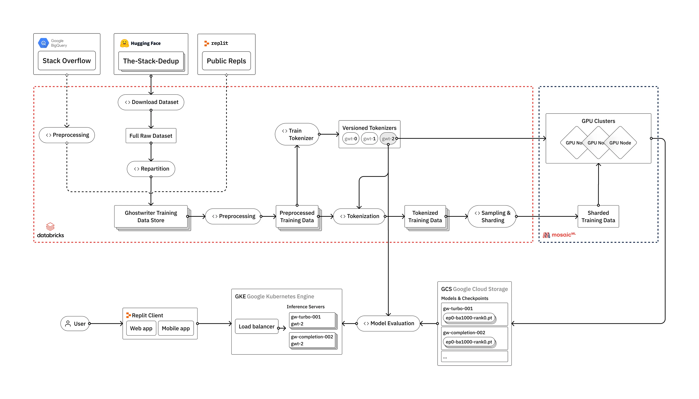

本文原文地址：https://blog.replit.com/llm-training

* 数据输入
    * Stack Overflow | The-Stack-dedup(Hugging Face) | Public Replit
* 数据处理
    * Databricks
    * Tokenization和Vocabulary Training
        * 训练我们自己的自定义词汇表，使我们的模型能够更好地理解和生成代码内容
* 模型训练
    * MosaicML
* 评估
    * HumanEval框架
        
备注：
* Databricks 是一家云计算公司，提供一个统一的数据分析平台，旨在帮助企业更高效地处理和分析大规模数据。
* Hugging Face 是一个领先的人工智能公司，专注于自然语言处理（NLP）和机器学习领域。
* MosaicML 是一家专注于提升机器学习模型训练效率和降低训练成本的公司。它提供了一个平台，用于优化和加速大规模机器学习模型的训练过程。

