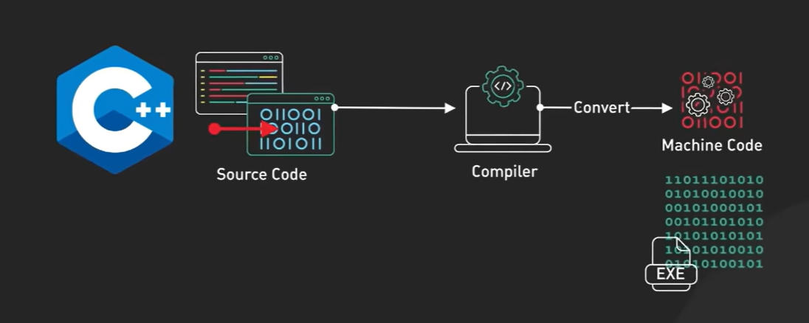
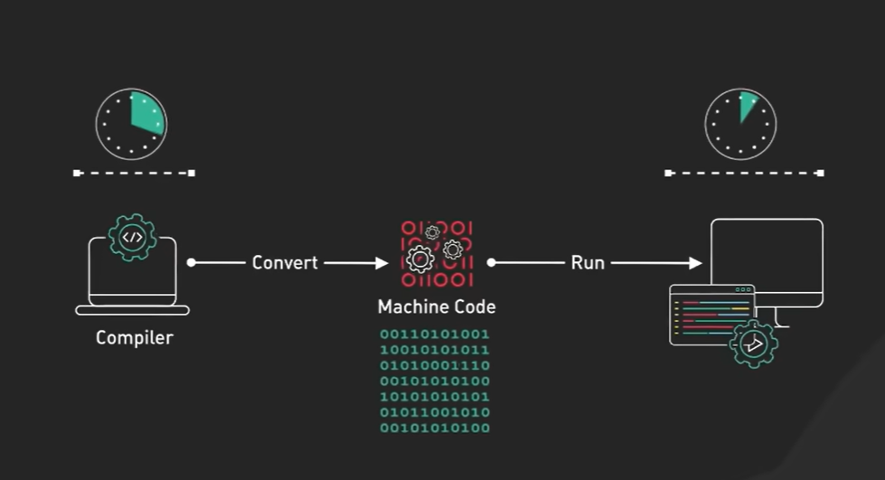
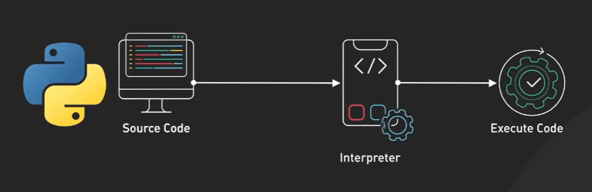
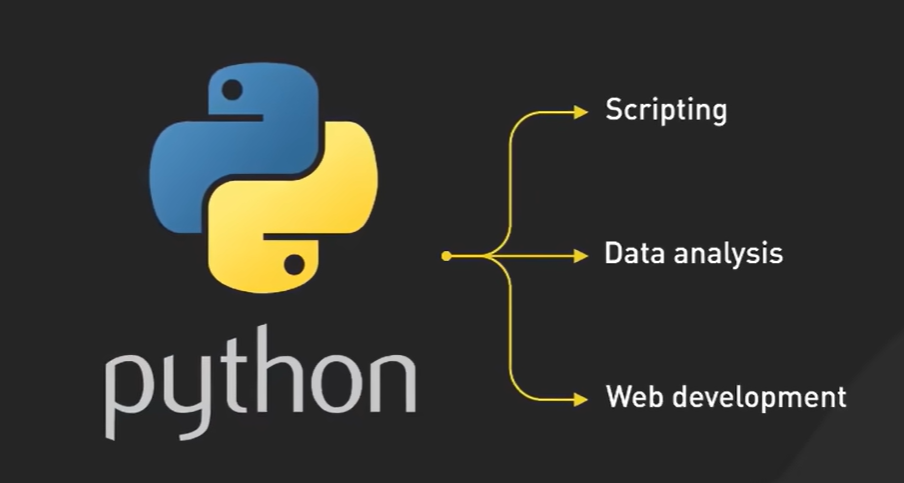
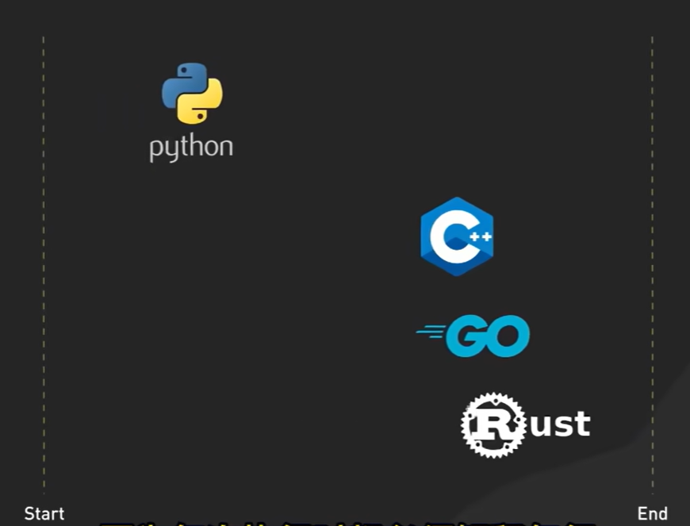
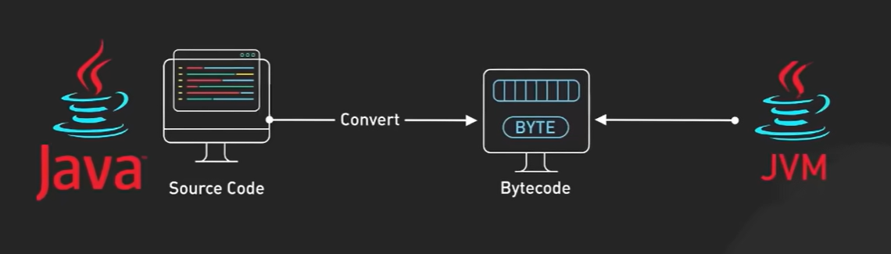
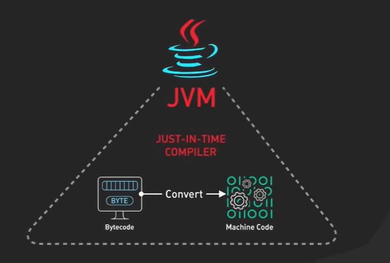
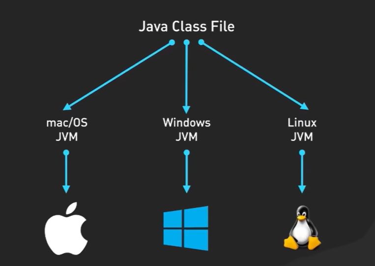
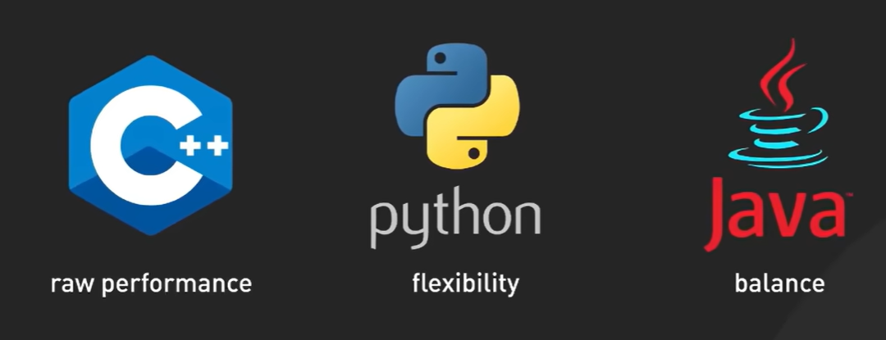

本文原文地址：https://www.bilibili.com/video/BV1UPpMeQEXW

# C++

C++ 编译过程：

运行

缺点：C++、Go和Rust等编译语言，最初需要更长的时间来编译
优势：但随后运行速度非常快,因为CPU不需要解释或即时编译代码

虽然 C++ 本身是跨平台的，但由于其对底层硬件的依赖较强，不同平台上的实现细节可能会有所不同。因此，要保证 C++ 程序的可移植性，通常需要更多的工作来处理不同平台的差异。

例如，x86和arm框架的区别

# Python

python 执行过程：

Python不进行编译, 而是将其源代码直接发送到解释器，这会即时读取并执行代码。

这个过程使Python异常灵活且用户友好，它非常适合**快速开发(原型设计)和可读性很重要的场景**。凭借其解释性,Python深受数据科学家、教育工作者和Web开发人员的喜爱。

适用场景：

各个语言运行速度：

# Java

Java 编译过程：

JVM有一个即时编译器,可以在执行之前动态地将性能关键的字节码转换为优化的本机机器代码。这意味着Java代码的运行速度比纯解释语言快很多

可移植性：由于JVM几乎适用于所有操作系统，因此Java代码可以在任何设备上运行而无需重新编译。Java还被设计为内存安全的，且具备自动内存管理等功能。这使得它非常适合应用于需要稳定性、安全性和可扩展性的大型、复杂企业应用程序。

# 总结

C++提供原始性能、Python灵活性,而Java则平衡两者。

当然，下面是关于Python、C++和Java这三种主流编程语言的更详细的对比表格：

| 特征/语言              | Python                           | C++                              | Java                             |
|------------------------|----------------------------------|----------------------------------|----------------------------------|
| **类型**               | 解释型                           | 编译型                           | 半编译半解释型                   |
| **执行效率**           | 相对较低                          | 非常高，接近机器语言             | 中等，通过JIT编译器提高效率       |
| **内存管理**           | 自动管理，使用垃圾回收机制         | 手动管理，需显式分配和释放内存     | 自动管理，带有垃圾回收机制         |
| **面向对象支持**       | 支持，但非强制                    | 支持，但非强制                    | 支持，且强制                     |
| **跨平台性**           | 依赖解释器，跨平台性好            | 需要针对不同平台编译，跨平台性差   | 极佳，依靠JVM实现跨平台           |
| **学习难度**           | 较容易，语法简洁                   | 较困难，语法复杂                   | 中等难度，有严格的语法规则         |
| **应用领域**           | 数据分析、Web开发、脚本编写、科学计算、机器学习等 | 系统软件、游戏开发、实时系统、嵌入式系统等 | Web应用、企业级应用、移动应用、大数据处理等 |
| **语法风格**           | 简洁、易读、强调代码可读性         | 复杂、灵活、接近底层硬件           | 结构化、面向对象、强制规范         |
| **开发效率**           | 高，因为语法简单且有很多库支持     | 低，因为需要手工管理很多细节       | 中等，有一定的代码量要求           |
| **库支持**             | 丰富，有大量第三方库支持           | 也有许多库支持，但不如Python多    | 有强大的标准库和生态系统           |
| **社区支持**           | 社区活跃，更新迅速                 | 社区成熟，历史悠久                  | 社区庞大，企业支持强               |
| **安全性**             | 内置安全性高，但需谨慎使用外部库   | 安全性较低，需开发者小心管理       | 内置安全性较高，有沙箱机制等       |

