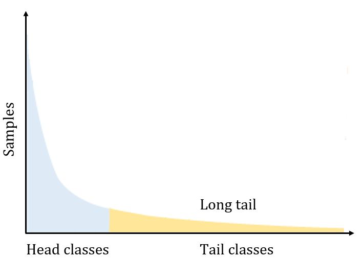

# 长尾分布

长尾分布（Long Tail Distribution）是一种统计分布模式，其中大量的观察值集中在分布的尾部，而头部（即高频区域）则相对较小。

数据分布呈现上图所示的分布被称之为长尾分布，顾名思义就是有很长的“尾巴”的分布。这样的分布是广泛存在于实际的训练数据中的，即有大量的ID，它们所拥有的样本数量十分稀少，有限的样本数量不足以代表这个类别真实的分布情况，这样的ID 被定义为tail class (图中黄色部分)。而少量的ID，其样本量充分，类内多样性丰富，这样的类别定义为head class(图中蓝色部分)。